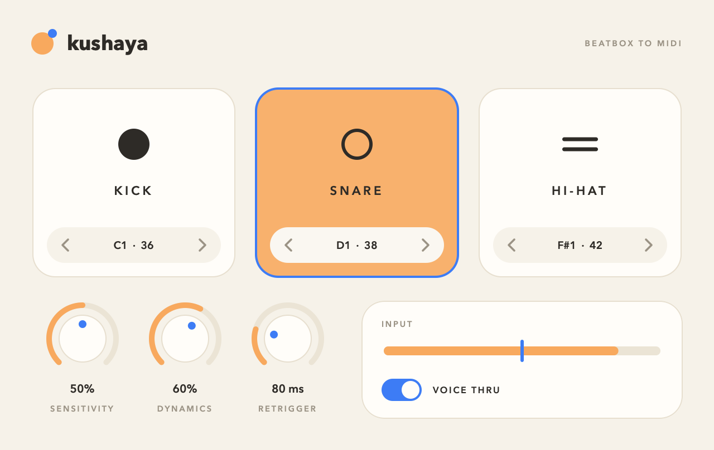

# Kushaya

Beatbox into a microphone and Kushaya turns each sound into a MIDI drum note: kick, snare or hi-hat.



There are two versions in this repo:

| | What it is | Reaction time |
|---|---|---|
| **The plugin** (`plugin/`) | A VST3 for your DAW, plus a standalone app | about 10 ms |
| **The Python prototype** (`src/`) | The original terminal scripts from Phases 1 and 2 | about 300 ms |

## The plugin

### Build and install

Needs macOS on Apple Silicon, the Xcode Command Line Tools, and CMake (`brew install cmake`).

```bash
./scripts/build_plugin.sh
```

The first run downloads JUCE and takes 5-10 minutes. It installs the plugin to
`~/Library/Audio/Plug-Ins/VST3/Kushaya.vst3` and builds a standalone app at
`build.nosync/plugin/Kushaya_artefacts/Release/Standalone/Kushaya.app`.

### Use it in Studio One

1. Restart Studio One so it finds the new plugin.
2. Put **Kushaya** (under Effects, VST3) on the audio track your microphone is on, and turn on that track's monitor button.
3. Add an instrument track with a drum sampler such as Impact XT.
4. Set the instrument track's input to **Kushaya** and turn on its monitor button.
5. Beatbox. The pads light up and the sampler plays.

### The controls

- **Pads** flash when their drum is detected. Click a pad to send its note, which is handy for checking the routing. The arrows change which MIDI note it sends (defaults: 36, 38, 42).
- **Sensitivity** sets how loud a sound must be to count as a hit. The blue line on the input meter shows the trigger level.
- **Dynamics** sets how much the loudness of your voice changes the note velocity. At 0% every hit is the same.
- **Retrigger** is the shortest allowed gap between two hits. Raise it if one sound triggers twice.
- **Voice Thru** passes your voice to the output. Turn it off to hear only the drums.

### Retrain it on new recordings

Put short `.wav` clips, one hit each, into `data/kick/`, `data/snare/` and `data/hihat/`, then:

```bash
./scripts/retrain.sh
```

This prints the accuracy on recordings the model has not seen, rewrites `plugin/core/Model.h`, and rebuilds the plugin. Restart your DAW afterwards.

### How it works

```
microphone -> OnsetCapture -> FeatureExtractor -> RandomForest -> MIDI note
              (spot a hit)    (describe 12 ms     (kick, snare
                               of it as 18         or hi-hat?)
                               numbers)
```

The same C++ code in `plugin/core/` extracts the features for training and inside the plugin, so the two always agree.

## The Python prototype

```bash
brew install portaudio
python3 -m venv venv
source venv/bin/activate
pip install sounddevice librosa scikit-learn numpy scipy joblib mido python-rtmidi

python src/train_classifier.py   # train on data/
python src/live_classify.py      # print detected sounds
python src/live_to_midi.py       # send MIDI to the "IAC Driver Bus 1" port
```

See `PHASE1_BRIEF.md` and `PHASE2_BRIEF.md` for details.

If this folder is inside iCloud Drive, the `venv` folder becomes very slow once iCloud moves its files to the cloud. Delete it and create it again if imports hang.

## Project layout

```
data/        training recordings (kick, snare, hihat)
plugin/
  core/      onset detection, features and the model (plain C++)
  src/       the plugin and its interface (JUCE)
  tools/     command-line test and training helpers
scripts/     build_plugin.sh, retrain.sh, train_plugin_model.py
src/         the Python prototype
build.nosync/  everything generated (not committed, not synced to iCloud)
```

## Licensing note

The plugin is built with [JUCE](https://juce.com), which is free for open-source (AGPLv3) projects and has its own commercial licence terms. Check those before selling the plugin.
